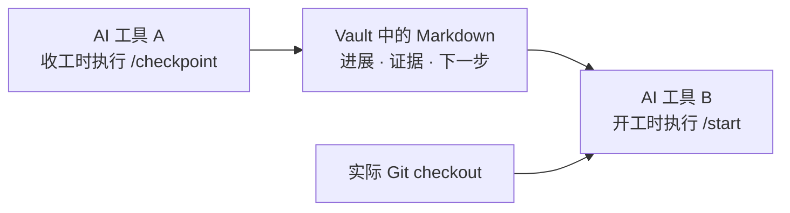

# PAWS

**Personal AI Work System · 个人 AI 智能体工作系统**

换一个 AI 工具，继续同一个项目。

做了几天的项目，换个模型、打开新会话，常常又要解释背景、约束和上次做到哪。PAWS 用本地 Markdown 记录这些信息。工作告一段落时执行 `/checkpoint`，下次在原工具或另一个已接入的工具里执行 `/start`，它就能读到同一份项目档案，并核对当前 Git 状态。

[快速体验](#快速体验) · [接入你的 AI 工具](#接入你的-ai-工具) · [项目档案](#项目档案) · [MIT 许可证](LICENSE)

## PAWS 能帮你做什么

| 你遇到的情况 | PAWS 提供的帮助 |
| --- | --- |
| 在不同 AI 工具之间接力 | Codex、Claude Code、OpenCode、Antigravity、Hermes 使用同一套项目文件和工作流正文，各自使用原生模型与工具。 |
| 隔天回来，不确定做到哪 | 接续时读项目目标、约束、上次停点和待办，再核对实际 checkout、提交与未提交改动。 |
| 两周后要追查当时的决定 | 在 worklog 里保留过程和验证结果，在 decisions 里记录取舍，待办可以指向具体证据。 |
| 想留下可复用的方法 | 手动提炼项目经验，审阅后再保存为知识卡或同源 Skill。 |



工作流由你主动触发。Vault 文件用普通编辑器即可查看，也可以纳入你自己的版本管理。

## 快速体验

准备 **Git、Python 3.10+**，在 macOS 或 Linux 的终端中运行。这个示例会在临时目录运行一个 Markdown 标题检查器，并为它创建 PAWS 项目档案。

```sh
git clone https://github.com/zhxuanlei-cmd/PAWS.git
cd PAWS
export VAULT_DIR="$(pwd -P)/vault"

demo="$(mktemp -d)"
cp -R examples/demo-project/. "$demo/"
git -C "$demo" init -q
(cd "$demo" && python3 check_notes.py sample.md)

"$VAULT_DIR/scripts/project_init.sh" quickstart --repo "$demo" --name "Markdown 标题检查器"
python3 "$VAULT_DIR/scripts/paws_repository.py" --vault "$VAULT_DIR" --cwd "$demo"
```

检查器应输出 `OK sample.md`，定位结果应包含 `"project": "quickstart"`。打开 `vault/10-projects/quickstart/HANDOFF.md`，可以看到这个项目的阶段、下一步和 Git 快照。

## 接入你的 AI 工具

再准备 **Node.js 24+** 及所选工具。选择一个工具安装，下面以 Codex 为例。先运行 `plan` 查看将创建的入口，再运行 `apply` 安装。已有入口来自其他工作区时，先处理安装器报告的冲突。

```sh
cd "$(dirname "$VAULT_DIR")"
host=codex
node vault/scripts/paws_setup.mjs plan --host "$host" --vault "$VAULT_DIR"
node vault/scripts/paws_setup.mjs apply --host "$host" --vault "$VAULT_DIR"
node vault/scripts/paws_setup.mjs doctor --host "$host" --vault "$VAULT_DIR"
```

可用的 `host` 值是 `codex`、`claude`、`opencode`、`antigravity`、`hermes`。要先在隔离目录试装，在当前终端设置 `test_home="$(mktemp -d)"`，再在三条命令末尾分别加上 `--home "$test_home"`。

在同一终端执行 `cd "$demo"`，从该目录启动已接入的工具。桌面客户端可直接打开这个目录，再在会话中提供 Vault 的绝对路径。

1. **开工**。点选 `paws-project-continuation`，或直接说「请按 PAWS 开工，接续项目 quickstart」。如果工具显示 PAWS 的 `/start`，也可以直接执行。Hermes 还可使用 `/paws-start`。
2. **工作**。请 AI 运行示例检查器并核对结果。
3. **收工并接力**。点选 `paws-checkpoint`，执行工具里可见的 `/checkpoint`，或明确要求按 PAWS 保存本次结果和下一步。打开另一个已接入的工具，对着同一个目录再按 PAWS 开工。

看不到 Skill 时，也可以直接向 AI 提供对应 [Skill 正本](vault/scripts/skills)的绝对路径，请它读取并执行。

> **OpenCode 和 Hermes。** OpenCode 的命令和 Skills 可独立安装。需要运行时策略时，先构建 Engine、安装 zsh，在原生 OpenCode 完成模型配置与登录，再运行 `paws-opencode`。启动器使用默认的 `~/.config/opencode/opencode.json`（标准 JSON）。如果你自定义了 `XDG_CONFIG_HOME`，可继续使用原生 OpenCode。Hermes 安装需要 PyYAML，可使用现有 Hermes 环境，也可按下方步骤安装 Python 依赖并设置 `PAWS_PYTHON="$(command -v python3)"`。

## 项目档案

开始自己的项目时，将建档命令中的 `quickstart`、`--repo` 和 `--name` 改成自己的项目标识、真实代码目录的绝对路径及显示名称。PAWS 会生成下面的档案，源码继续由原来的仓库维护。

| 文件 | 回答的问题 |
| --- | --- |
| `<项目>-主页.md` | 这个项目给谁用，预期做到什么？ |
| `spec.md` | 有哪些需求、技术约束和验收标准？ |
| `HANDOFF.md` | 做到哪了，目前有什么阻塞，下一步是什么？ |
| `tasks.md` | 哪些事待办、已完成或已取消？ |
| `worklog/` 与 `decisions/` | 做过什么验证，关键选择是怎么定的？ |

这个公开仓库的忽略规则会排除你新建的项目档案和知识卡。需要备份或跨设备接续时，用自己的 Vault 仓库同步档案，并在新设备核对代码目录映射。

查看完整的[示例项目](vault/10-projects/demo/demo-主页.md)。除了日常的 `/start` 和 `/checkpoint`，你也可以用 `/inbox` 整理收件箱、`/reflect` 审阅知识、`/harvest` 提炼项目经验、`/archive` 归档项目，以及 `/consolidate` 整理已开展的项目。具体入口与规则见 [Vault 工作约定](vault/AGENTS.md)。

## 构建和验证

使用 Engine CLI、OpenCode 运行时策略，或参与开发时，在仓库根目录运行。

```sh
python3 -m venv .venv
. .venv/bin/activate
python -m pip install -r vault/requirements.txt

npm --prefix engine ci
npm --prefix engine run build
node engine/dist/src/cli.js doctor
pack_dir="$(mktemp -d)"
node engine/dist/src/cli.js context build --project demo --output "$pack_dir/context.json"
node engine/dist/src/cli.js context verify --file "$pack_dir/context.json"
```

`doctor` 检查 Engine 与 Vault，接下来的命令在临时目录生成样例 Context Pack 并核对其来源。日常接续以项目 Markdown 与实际 Git 状态为准。OpenCode 启动器安装后位于 `~/.local/bin/paws-opencode`。可用 `OPENCODE_REAL_BIN` 指定原生 OpenCode 的可执行文件。

<details>
<summary>运行测试套件</summary>

```sh
npm --prefix engine test
node --test vault/scripts/tests/*.test.mjs
python -B -m unittest discover -s vault/scripts/tests -p 'test_*.py'
bash vault/scripts/tests/test_derived_state.sh
bash vault/scripts/tests/test_project_init.sh
bash vault/scripts/fm_lint.sh
bash vault/scripts/check_moc_coverage.sh
```

</details>

[Engine 使用说明](engine/README.md) · [MIT 许可证](LICENSE)
